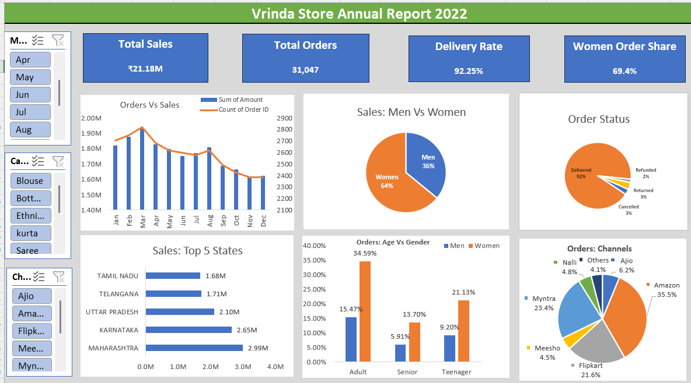

# vrinda-store-data-analysis
Vrinda Store 2022 sales analysis and interactive Excel dashboard

## Project Overview

This project analyzes Vrinda Store's 2022 sales data using Microsoft Excel.
The objective is to identify sales trends, customer demographics,
top-performing states, order status, and sales channels through an
interactive Excel dashboard.

## Tools & Skills

- Microsoft Excel
- PivotTables
- PivotCharts
- Slicers
- Data Cleaning
- Data Analysis
- Dashboard Development

## Dataset

The dataset contains 31,047 transaction records with information on:

- Order ID, Customer ID
- Gender, Age, Age Group
- Order Date, Month
- Order Status
- Sales Channel
- Product Category, SKU, Size, Quantity
- Sales Amount
- Shipping city, state, postal code, country
- B2B flag

## Dashboard

   

## Key Insights

- Women customers contributed approximately 64% of total sales.
- Maharashtra was the top-performing state with approximately ₹2.99M in sales.
- Amazon was the leading order channel, contributing approximately 35% of orders.
- The overall delivery rate was approximately 92%.
- Monthly sales peaked in March at approximately ₹1.93M.
- Amazon, Myntra and Flipkart together contributed nearly 80% of orders.

## Dashboard Features

- Monthly Sales & Orders Analysis
- Gender-wise Sales Analysis
- Order Status Analysis
- Top 5 States by Sales
- Age & Gender Analysis
- Channel-wise Order Analysis
- Interactive Slicers (Month, Category, Channel)

## Business Recommendations

- Focus marketing efforts on women customers, who represent the majority
  of sales and orders.
- Strengthen customer acquisition and retention strategies in
  Maharashtra, Karnataka and Uttar Pradesh.
- Optimize campaigns across Amazon, Myntra and Flipkart, which generate
  the majority of orders.
- Monitor returns and cancellations to identify opportunities for
  improving customer experience.

## Files

- `Vrinda Store Data Analysis.xlsx` – Excel workbook containing the raw data,
  analysis and interactive dashboard.
- `dashboard.png` – Preview of the final dashboard.
